<p align="center">
  
</p>

<p align="center">
  <a href="LICENSE"></a>
  
  
  
</p>

<p align="center">
  <b>Everything you glance at while Claude works, in one quiet column of light.</b><br>
  <sub>Where you are · how much room is left · what it cost · what is running for you</sub>
</p>

<br>

<table align="center">
  <tr>
    <td width="460" valign="top">
      
    </td>
    <td valign="top">

### ◆ &nbsp;Where you are

Project, branch or worktree, uncommitted files and the session's age on **one line**, with the session's title and short id beneath it.

### ▍ &nbsp;Usage

Your **5-hour**, **weekly** and **Fable** windows as segmented meters that warm from green to rose, each with its reset countdown.

### ▍ &nbsp;Context

Tokens used against the window, the model in the title, and a full-width **rainbow bar** that glints while Claude thinks.

### ▍ &nbsp;Spend

This month's spend **by model**, ranked, plus the open session, summed into a running total.

### ▍ &nbsp;Live work

**Ultracode** appears while it is on, with the last workflow's result.

### ▍ &nbsp;Office

After the spend, an office of robots seen from above: a wall of windows, a navy carpet of desks whose monitors scroll code while their worker types, swaying plants down the left wall and a break area on its own carpet (steaming coffee, a bubbling water cooler, snacks) on the right, with a whiteboard over it showing each workflow's name, done/running/failed counts, time and a progress bar. The main robot, Claude, keeps the first desk while it works and at rest wanders to the coffee, the water and the team. Every agent is a chubby robot that walks in along the aisles, takes a desk and lights its monitor, with a status pill naming the tool it is using and its task beneath; idle for 30 s it nods off (zᶻ), and done it celebrates, takes a break, and heads out when its run closes. Under the room a roster lists every task in full with an estimated progress bar (its time against its finished peers' average; a shimmer until one finishes), model, time and tool count.

Usage and spend fold to one line each, usage to every window's share (`5h 34% · wk 12% · f ∞`) and spend to the month's total; ▸ (or `u` / `s` while the sidebar has focus) opens one, and the choice is remembered.

</td>
  </tr>
</table>

<br>

## Install

At the prompt of a Claude Code terminal session:

```text
/plugin install aurora --marketplace zivkong/chromadock
```

Answer `y` to add the marketplace, then press <kbd>Enter</kbd> for the user scope. The sidebar opens in every session from then on.

<details>
<summary>From a shell, or the desktop app</summary>

<br>

```sh
claude plugin install aurora --marketplace zivkong/chromadock
```

In the desktop app, where `/plugin` does not run: click **+** next to the prompt box → **Plugins** → **Add marketplace** with `zivkong/chromadock` → **Add plugin**.

</details>

## Use

| | |
| :-- | :-- |
| **Where it lives** | Docked on the right in Claude Code's **fullscreen** mode, 56 columns wide (room for three desks across in the office; a narrower dock fits fewer); a width you drag the dock to wins. |
| **Opening it** | Opens by itself on a terminal of 144 columns or more. Anywhere else, type `/aurora`. |
| **Motion** | Colours drift and spinners turn only while something runs; at rest the sidebar holds perfectly still. |

## Reading the numbers

> [!NOTE]
> **Spend is at API prices.** It sums the session totals Claude Code saves in your local transcripts, plus the open session's live cost. On a subscription that is a measure of usage, not your bill.

- **`∞` on a limit** means Claude Code reported no reading for that window, not a guarantee that no cap exists. `/usage` shows your account's real limits.
- **A session open in another window** joins the month's total when it ends; a session that spans two months counts in the month it ends.
- **Ultracode** lights up when the session's reasoning effort is `xhigh` or `max`.

## How it works

chromadock is a single hooks module with no dependencies beyond the Claude Code mod API, plus two small Python scripts:

| | |
| :-- | :-- |
| `hooks/register.tsx` | Listens to session, turn, tool, agent and usage events and draws the sidebar and its office of robots. |
| `scripts/month-spend.py` | Sums the month's spend from `~/.claude/projects`. It remembers where it stopped in each transcript, so after the first run it reads only new lines (milliseconds). |
| `scripts/session-title.py` | Reads the session's title: a name from `/rename` wins over the generated one. |

Nothing leaves your machine: every figure comes from Claude Code itself or from files already on your disk. Progress for the spend scan is kept in `~/.cache/aurora/month-spend.json`.

**Requirements:** Claude Code with mod support in fullscreen mode, and `python3` and `git` on your `PATH`.

## License

MIT — see [LICENSE](LICENSE).
