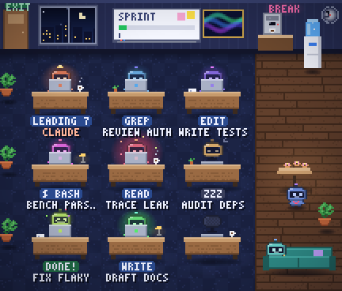
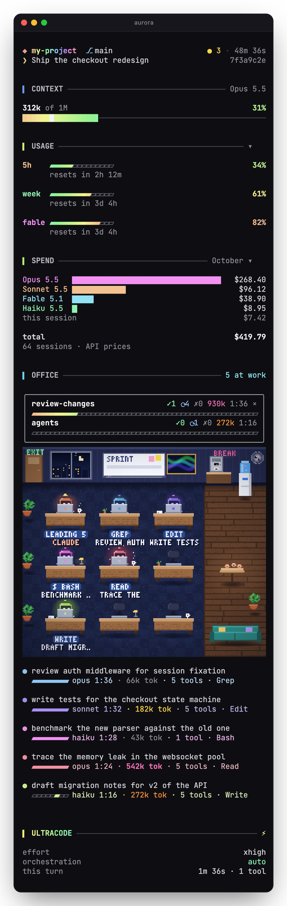
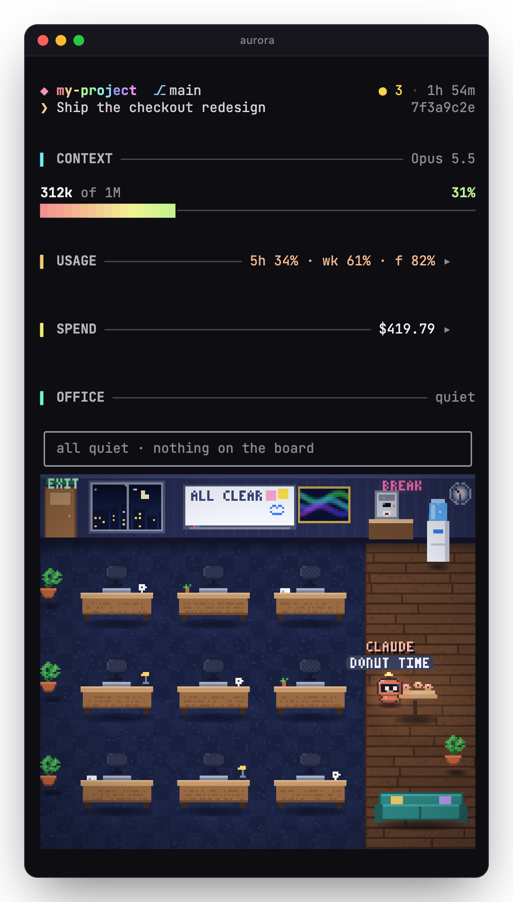

<p align="center">
  
</p>

<p align="center">
  <a href="LICENSE"></a>
  
  
  
  
</p>

<p align="center">
  <b>Everything you glance at while Claude works, in one quiet column of light.</b><br>
  <sub>Where you are · how much room is left · what it cost · who is at work for you</sub>
</p>

<br>

<p align="center">
  
</p>

<p align="center">
  <sub><b>The office, live.</b> Every subagent is a robot at a desk. The one running hot glows, the finished one cheers, the idle ones take a break on the sofa.</sub>
</p>

<br>

<table align="center">
  <tr>
    <td width="460" valign="top">
      
    </td>
    <td valign="top">

### ◆ &nbsp;Where you are

Project, branch or worktree, uncommitted files and the session's age on **one line**, with the session's title and short id beneath it.

### ▍ &nbsp;Context

Tokens used against the window, the model in the title, and a full-width **rainbow bar** that glints while Claude thinks.

### ▍ &nbsp;Usage

Your **5-hour**, **weekly** and **Fable** windows as segmented meters that warm from green to rose, each with its reset countdown.

### ▍ &nbsp;Spend

This month's spend **by model**, ranked, plus the open session, summed into a running total.

### ▍ &nbsp;Office

A **whiteboard** of every workflow (done ✓, running ⟳ and failed ✗ counts, tokens, time and a progress bar), the office itself, and a **roster** of every task still at work: an estimated progress bar, model, time, tokens, tool count and the last tool it called.

### ▍ &nbsp;Ultracode

While it is on: the effort level, the current turn's time and tool count, and the last workflow's result.

<br>

> Usage and spend **fold to one line** each. ▸ (or <kbd>u</kbd> / <kbd>s</kbd> while the sidebar has focus) opens one, and the choice is remembered.

</td>
  </tr>
</table>

<br>

## The office



In terminals that draw pictures (**Ghostty, kitty, iTerm2, WezTerm**; not inside tmux) the office is **animated pixel art**. Everywhere else the same office is drawn in text cells.

**The room.** A night wall of windows over a twinkling city, an exit door, a live team whiteboard, an aurora painting and a wall clock with the real time. Wooden desks where robots peek over laptops whose lids glow in their colour, each desk with its own mug, succulent, papers or lamp. Monstera plants, and a lounge on warm planks with a steaming espresso machine, a bubbling water cooler, a donut table and a sofa.

**Claude** (in coral, with a little star) works at the first desk. At rest it wanders to the coffee, the window, the water, the donuts and the sofa, as on the right.

**Every agent** is a chubby robot with its own colour and kit (headphones, a bow tie, a sprout):

- 🚪 **Arrives**: walks in through the door and sits down to type, its status pill naming the tool it is using.
- 💤 **Idle 30 s**: dozes at its desk.
- ☕ **Idle a minute** (or parked by the engine): gives up its desk for a break on the sofa or around the lounge, six at a time, and walks back to a free desk the moment its task goes on.
- 🎉 **Done**: cheers in confetti and walks out the door. An agent resumed after that comes back in as a new robot.

**Running hot.** A robot glows in its own colour by its tokens: softly from **100k**, strongly from **250k**, and from **500k** it pulses with sparks. Claude glows by the main session's context.

**Tokens** are counted as `/workflows` counts them: an agent's are the size of its latest request, a workflow's the sum of its agents'.

**Coming and going.** A finished task leaves the roster at once; the whiteboard keeps its count. A workflow comes off the whiteboard the moment Claude Code reports it completed, failed or stopped, and each workflow's line ends in a **×** that dismisses it by hand. An agent of a workflow not heard from for half an hour is taken as finished, and comes back if it turns out to be still at work.

## Install

At the prompt of a Claude Code terminal session:

```text
/plugin install chromadock --marketplace zivkong/chromadock
```

Answer `y` to add the marketplace, then press <kbd>Enter</kbd> for the user scope. The sidebar opens in every session from then on.

<details>
<summary>From a shell, or the desktop app</summary>

<br>

```sh
claude plugin install chromadock --marketplace zivkong/chromadock
```

In the desktop app, where `/plugin` does not run: click **+** next to the prompt box → **Plugins** → **Add marketplace** with `zivkong/chromadock` → **Add plugin**.

</details>

## Use

| | |
| :-- | :-- |
| **Where it lives** | Docked on the right in Claude Code's **fullscreen** mode, 56 columns wide (room for three desks across in the office; a narrower dock fits fewer). A width you drag the dock to wins. |
| **Opening it** | Opens by itself on a terminal of 144 columns or more. Anywhere else, type `/chromadock`. |
| **Folding** | ▸ next to **Usage** or **Spend**, or <kbd>u</kbd> / <kbd>s</kbd> while the sidebar has focus. Remembered across sessions. |
| **Motion** | Colours drift and spinners turn only while something runs. At rest the sidebar holds perfectly still. |

## Reading the numbers

> [!NOTE]
> **Spend is at API prices.** It sums the session totals Claude Code saves in your local transcripts, plus the open session's live cost. On a subscription that is a measure of usage, not your bill.

- **`∞` on a limit** means Claude Code reported no reading for that window, not a guarantee that no cap exists. `/usage` shows your account's real limits.
- **A session open in another window** joins the month's total when it ends; a session that spans two months counts in the month it ends.
- **A roster progress bar** is an estimate: the task's time against its finished peers' average. Until one of them finishes, it shimmers.
- **Ultracode** lights up when the session's reasoning effort is `xhigh` or `max`.

## How it works

chromadock is a single hooks module with no dependencies beyond the Claude Code mod API, plus two small Python scripts:

| | |
| :-- | :-- |
| `hooks/register.tsx` | Listens to session, turn, tool, agent and usage events and draws the sidebar, and its office in text cells. |
| `hooks/pixel-office.ts` | Paints the pixel-art office frame by frame: sprites, a 3×5 pixel font, the scene and its animations. |
| `scripts/month-spend.py` | Sums the month's spend from `~/.claude/projects`. It remembers where it stopped in each transcript, so after the first run it reads only new lines (milliseconds). |
| `scripts/session-title.py` | Reads the session's title: a name from `/rename` wins over the generated one. |

Nothing leaves your machine: every figure comes from Claude Code itself or from files already on your disk. Progress for the spend scan is kept in `~/.cache/chromadock/month-spend.json`.

**Requirements:** Claude Code with mod support in fullscreen mode, and `python3` and `git` on your `PATH`.

## License

MIT — see [LICENSE](LICENSE).
